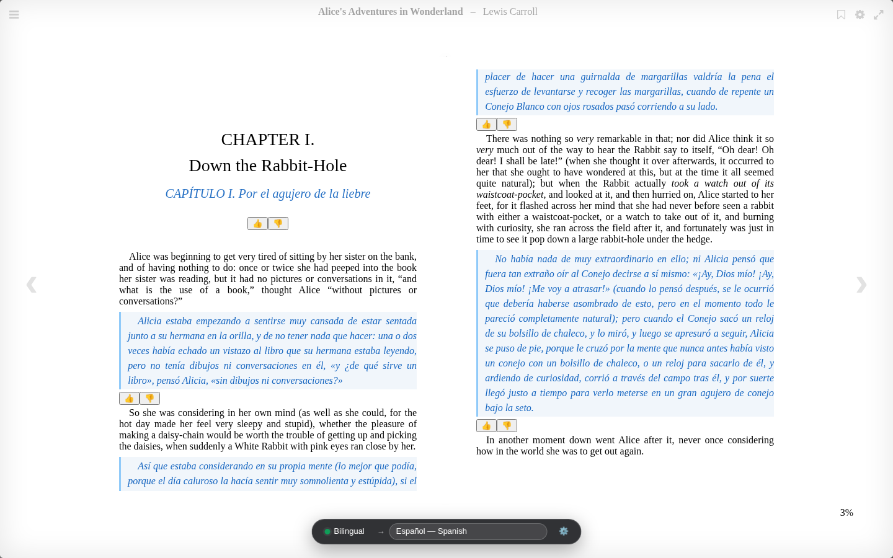

# Book Translator Hub

<p align="center">
  
</p>

<p align="center">
  <a href="https://github.com/felixapel/book-translator-hub/releases/latest"></a>
  <a href="https://github.com/felixapel/book-translator-hub/actions"></a>
  <a href="LICENSE"></a>
  
  
  <a href="https://github.com/sponsors/felixapel"></a>
  <a href="https://ko-fi.com/felixapel"></a>
</p>

<p align="center">
  <b>Read DRM-free EPUBs next to their translation, inside the stock Calibre-Web-Automated and Kavita web readers.<br>
  Translation runs on your own LLM server or on a cloud API you choose.</b>
</p>

---

<p align="center">
  
  <br><sub>Real screenshot: the stock CWA 4.0.8 web reader in bilingual mode, English → Spanish, translated by a local Qwen model.
  Book: <i>Alice's Adventures in Wonderland</i> (public domain, Project Gutenberg).</sub>
</p>

## ✨ Features

- **Three reading modes:** Original, Bilingual (each paragraph followed by its translation) and Translated, cycled from a small floating toolbar.
- **102 target languages:** The source language is detected from book metadata and HTML, with a manual override.
- **Per-book glossary:** Pin how names and terms are translated so they stay consistent across chapters.
- **Visible work first:** The first visible paragraph is sent on its own, and visible paragraphs go ahead of a bounded lookahead window. Latency still depends on the provider, model, network and cache.
- **Layered cache:** An in-memory cache in the browser and a private SQLite (WAL) cache on the server, so a re-read chapter is not translated again. Managed profiles do not store translated text in browser storage.
- **Export:** Save the translated chapter as a small EPUB for offline reading.
- **Manual activation:** Every book opens with translation off. Book text is sent only after the reader turns a mode on.
- **E-Ink display mode:** A high-contrast, low-motion presentation for compatible e-readers; verify it on your device.
- **Stock readers, no fork:** A proxy injects one script tag into the stock CWA or Kavita page. Upstream images and libraries are never modified, and translations are never written back.
- **Server-side credentials:** Provider API keys stay in the private server environment and never reach the browser.

## 🧩 At a glance

| | |
|---|---|
| **Readers** | Stock [Calibre-Web-Automated](https://github.com/crocodilestick/Calibre-Web-Automated) 4.x and stock [Kavita](https://www.kavitareader.com/) `0.9.0.2` / `0.9.1.4`, EPUB web reader only. Exact versions: [compatibility matrix](docs/reference/compatibility.md). |
| **LLM providers** | Any local OpenAI-compatible server (vLLM, Ollama, LM Studio); OpenAI, Anthropic, Gemini, Groq, Together, DeepSeek, MiniMax and OpenRouter; or a custom OpenAI-compatible endpoint. |
| **Installation** | `btctl` universal hub on Unraid or Linux with Docker (CWA, Kavita or both), or the CWA-only Community Applications template on Unraid. |
| **Container image** | `ghcr.io/felixapel/cwa-ebook-translate-plugin`, `linux/amd64`, pinned by digest, with SBOM and provenance attestations. |
| **Privacy** | No telemetry, ads or accounts. With a local LLM and no cloud fallback, book text stays on your network. A cloud provider receives the paragraphs it translates. |
| **License** | GPL-3.0 |

## 🚀 Installation

**You need:** a Docker host (stock Unraid 7.3.x or Linux with Docker Engine and the Compose plugin, x86_64), a running stock CWA and/or Kavita, and an LLM endpoint or a cloud API key.

Choose a tag from the [published releases](https://github.com/felixapel/book-translator-hub/releases).
`VERSION` identifies the checked-out source; changes on `main` may not yet be
available in a published release. See the [release process](docs/maintainers/release.md)
for the acceptance and publication requirements.

The production path is the universal `btctl` hub. It builds an immutable local
image from an exact clean checkout and runs CWA, Kavita or both through
one hardened container while keeping separate internal API processes, caches,
keys and cookies:

```bash
git clone https://github.com/felixapel/book-translator-hub.git book-translator-hub
cd book-translator-hub
# Select an immutable published tag from the GitHub Releases page before installing.
git switch --detach vX.Y.Z
```

Copy the managed configuration outside the checkout and make it private:

```bash
install -d -m 0700 /absolute/private/path
cp .env.hub.example /absolute/private/path/book-translator-hub.env
chmod 0600 /absolute/private/path/book-translator-hub.env
```

Set each enabled reader's exact container, network, version, public origin and
storage paths. The managed template defaults to a local OpenAI-compatible
provider. Replace its placeholder endpoint and model in the private copy:

```dotenv
BT_ENABLE_CWA=true
BT_ENABLE_KAVITA=true
LLM_PROVIDER=local
LLM_MODEL=local-model
LLM_API_KEY=
BT_LOCAL_URL=http://local-llm:8000/v1/chat/completions
```

A named cloud provider uses its fixed HTTPS endpoint and a server-side API key;
review its privacy and quota implications first. A ChatGPT, Codex, Gemini or
Antigravity consumer subscription is not an API credential. Then run:

```bash
./btctl plan --env /absolute/private/path/book-translator-hub.env
./btctl install --env /absolute/private/path/book-translator-hub.env --yes
./btctl doctor --env /absolute/private/path/book-translator-hub.env
```

`plan` validates and reports the intended resources without changing the reader
or deployment state. `install` commits state only after live postconditions pass.
`doctor` is read-only and every check must report `ok`. Open your reader through
the configured public origin, open an EPUB and click **Original** on the toolbar
to switch modes.

To change the provider later, run a reviewed `uninstall` with the old
environment, then `install` with the new one. Translation data is kept;
session keys are regenerated, so open tabs may need a reload. See the
[configuration reference](docs/reference/configuration.md) for batching,
fallback and per-reader provider settings.

Stock Unraid requires root, Bash, Docker and a full checkout including `.git`.
It does not require host Python, host Git or NerdTools to run `./btctl`; the
launcher uses a temporary containerized operator when needed. Linux hosts use
`BT_INSTALL_PROFILE=compose-existing`. Operators who need independent
container isolation or CWA Authentik-forwarded identity can retain the split
profile. The full walkthrough is in the [`btctl` guide](docs/install/btctl.md).

Community Applications uses a separate CWA-only combined-image profile with a
digest-pinned image; search for **book-translator-hub** in the Apps tab. See the
[Community Applications guide](docs/install/community-applications.md).

## 🛡️ Runtime boundary

```text
Browser / reverse proxy -> injection proxy -> stock CWA or Kavita
                                  |
                                  +-> private translation API -> LLM
                                                     |
                                                     +-> SQLite cache
```

Managed native-reader profiles exchange existing CWA or Kavita proof for a
short-lived, opaque translator session. Raw reader credentials are confined to
the exact exchange endpoint; ordinary translation calls never receive them.
CWA strong-session binding and Kavita native/OIDC login are supported within
their documented boundaries. Do not publish the API, disable authentication,
or add a route that bypasses the managed proxy. Advanced CWA Authentik
deployments have a separate fail-closed profile and guide.

CWA `4.0.6` is the exact CWA contract reference and `4.0.8` is browser-accepted.
Kavita has separate exact `0.9.0.2` and `0.9.1.4` contracts. `0.9.1.4` with
stock OIDC login is browser-accepted on the managed hub; its native-password
login is covered only by an isolated contract fixture. See the
[compatibility matrix](docs/reference/compatibility.md) before choosing a
reader version. Manga, PDF and library writeback are not supported.

## 📖 Documentation

- [Documentation map](docs/README.md)
- [Universal CWA and Kavita hub](docs/install/universal-hub.md)
- [Managed `btctl` install](docs/install/btctl.md)
- [Kavita managed install](docs/install/kavita.md)
- [Community Applications](docs/install/community-applications.md)
- [Authentik integration](docs/install/authentik.md)
- [Lifecycle and recovery](docs/operations/lifecycle.md)
- [Troubleshooting](docs/operations/troubleshooting.md)
- [Compatibility](docs/reference/compatibility.md)
- [Configuration](docs/reference/configuration.md)
- [Architecture](docs/reference/architecture.md)

## 🤝 Development and support

Read [CONTRIBUTING.md](CONTRIBUTING.md) and the
[development guide](docs/maintainers/development.md) before changing the
project. Use the issue templates for reproducible bugs and feature proposals.
Report vulnerabilities through the private channel in [SECURITY.md](SECURITY.md).

## 💖 Sponsors

Book Translator Hub is free GPL-3.0 software with no telemetry, ads or
subscription, maintained independently. If it helps your reading, you can
support hardware for E-Ink device testing and local GPU benchmarks:

<p align="center">
  <a href="https://github.com/sponsors/felixapel">
    
  </a>
  &nbsp;&nbsp;
  <a href="https://ko-fi.com/felixapel">
    
  </a>
</p>

The project is not affiliated with or endorsed by CWA, Kavita, Calibre, Google
or any LLM provider. See [LICENSE](LICENSE) for the license text.
